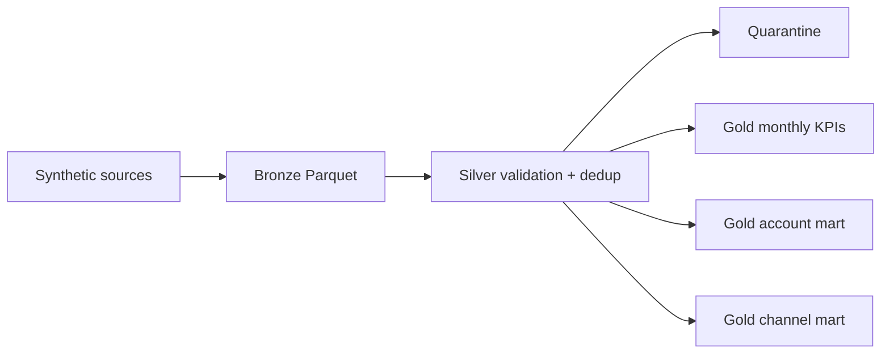
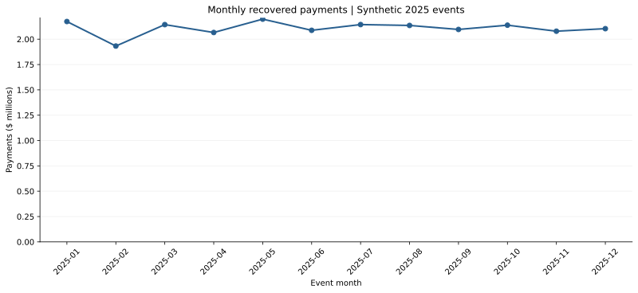
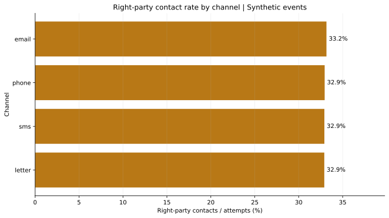

# Collections Medallion Pipeline | PySpark Data Engineering

**Aditya Gujral · Spark / Data Engineering / Collections Analytics**

A reproducible medallion-style batch pipeline that turns **300,275 synthetic event deliveries** into **300,000 canonical events**, quarantines invalid rows, preserves incremental batch versions, and publishes operational collections marts.

This project adds hands-on PySpark and data-engineering evidence to the portfolio. It was executed locally with **Apache Spark 4.0.1** and Java 17. It does **not** claim Databricks, Azure, Delta Lake, streaming, or cloud-cluster execution.

All records are fictional. No employer, customer, consumer, bureau, or confidential data is used.

[Read findings](FINDINGS.md) · [Open executed notebook](collections_pipeline_analysis.ipynb) · [Architecture and definitions](docs/ARCHITECTURE.md) · [Validation receipt](outputs/validation.json)

## Portfolio results

| Measure | Synthetic result |
|---|---:|
| Registered accounts | 50,000 |
| Raw deliveries | 300,275 |
| Canonical events | 300,000 |
| Redelivered rows removed | 272 |
| Invalid rows quarantined | 3 |
| Active accounts in marts | 49,896 |
| Payments recovered | $25.30 million |
| Recovery / active-account starting balance | 5.01% |
| Validation | 12 reconciliations + 8 tests passed |

## Architecture



- **Bronze:** explicit schemas; raw event deliveries retained by ingest batch.
- **Silver:** timestamp and amount validation, account-reference checks, quarantine reasons, event-ID deduplication, and event-month Parquet partitions.
- **Gold:** monthly region/product KPIs, active-account recovery balances, and channel contact metrics.
- **Evidence:** compact CSV outputs, findings, figures, independent raw-file reconciliation, and tests.

Silver versions are written as `events_batch_01` and `events_batch_02`. Batch 2 unions the prior version, prefers the latest delivery for repeated `event_id`, and publishes a new immutable version. This is a deterministic local demonstration—not a concurrent ACID `MERGE`.

## Reproduce

Requires Python 3.12, Java 17, and a local environment that permits Spark to bind a loopback driver port.

```bash
cd portfolio/collections_medallion_pipeline
python -m venv .venv
# macOS / Linux
source .venv/bin/activate
# Windows PowerShell alternative:
# .venv\Scripts\Activate.ps1
python -m pip install -r requirements.txt
python -m src.generate_data
SPARK_LOCAL_IP=127.0.0.1 python -m src.pipeline
python validate_outputs.py
python -m unittest discover -s tests -v
python build_report.py
python create_notebook.py
```

On Windows PowerShell, set the loopback environment variable with `$env:SPARK_LOCAL_IP='127.0.0.1'` before running the pipeline.

The raw files are around 60 MB and the local Parquet lake around 18 MB; both are excluded from Git and rebuilt deterministically with seed `20261012`. The compact evidence outputs and SVG figures are committed.

## Data-quality behavior

Batch 2 deliberately includes:

- 272 exact redeliveries from batch 1;
- one unknown account;
- one malformed timestamp;
- one negative payment.

The final Silver version contains 300,000 rows and 300,000 distinct event IDs. The three invalid rows land in quarantine with explicit reasons. Unknown future schema changes are not silently accepted because input fields and types are declared in `src/schemas.py`.

## Analytical outputs



The pipeline produces monthly payments, contact attempts, right-party contacts, promises-to-pay, RPC rate, and PTP-per-RPC by month, region, and product. It also calculates account-level remaining balance and recovery rate.



Email's generated RPC rate is 33.15%, only 0.25 percentage points above the lowest channel. Every channel shares the same underlying outcome distribution, and payments are independent of contacts. This chart demonstrates KPI construction—not campaign impact or causal effectiveness.

## Validation

`validate_outputs.py` uses Python's standard library, not Spark aggregations, to reread the raw CSV/JSONL deliveries and independently rebuild:

- canonical delivery counts and duplicate removals;
- quarantine reason counts;
- event-type counts and recovered cents;
- active-account starting and remaining balances;
- channel and monthly Gold marts;
- final Silver event-key uniqueness.

All **12 reconciliations** and **8 contract tests** pass. Raw-input SHA-256 hashes are stored in [validation.json](outputs/validation.json).

The Spark pipeline itself ran successfully in the local runtime. Native Jupyter-kernel startup was blocked by the runtime's socket restrictions, so the four notebook code cells were instead executed sequentially in a fresh Python subprocess; all completed without errors, and the generated static figures were visually inspected. The notebook remains a standard Jupyter notebook, but native-kernel execution was not verified here. See [notebook_validation.json](outputs/notebook_validation.json) and [pipeline_execution.json](outputs/pipeline_execution.json).

## What the results mean—and do not mean

Personal Loan contributes the most recovered dollars ($8.47M), but product totals reflect synthetic account mix and event volume. The 5.01% cash recovery ratio uses active-account starting balances; it is not cure rate, liquidation rate, profitability, or program lift.

The project has no contact consent, legal restrictions, hardship status, staffing costs, agent capacity, profitability, treatment/control assignment, or real consumer data. It must not be used to infer channel effectiveness or operational policy. The active-account mart excludes 104 registered accounts with no events.

For production, add transactional lakehouse storage, orchestration, concurrency controls, schema-evolution policy, secrets and access management, monitoring, lineage, retention, late-event rules, regulatory controls, and governed metric definitions.

## Files

| Path | Purpose |
|---|---|
| `src/generate_data.py` | Deterministic synthetic batch generator |
| `src/schemas.py` | Explicit Spark schemas |
| `src/pipeline.py` | Bronze/Silver/Gold PySpark pipeline |
| `validate_outputs.py` | Independent raw-file reconciliation |
| `tests/test_contract.py` | Eight pipeline contract tests |
| `build_report.py` | Findings, product summary, and charts |
| `collections_pipeline_analysis.ipynb` | Executed analytical companion |
| `docs/ARCHITECTURE.md` | Grain, rules, KPI definitions, and production gaps |
| `outputs/` | Compact marts and validation evidence |

## Resume bullet

Built and validated a PySpark medallion pipeline for 300K synthetic collections events, implementing schema enforcement, quarantine routing, idempotent event-key deduplication, partitioned Parquet Silver tables, Gold KPI marts, and 20 independent checks/tests.

## Primary technical sources

- [Apache Spark: Parquet files](https://spark.apache.org/docs/latest/sql-data-sources-parquet.html)
- [Apache Spark: SQL performance tuning](https://spark.apache.org/docs/latest/sql-performance-tuning.html)
- [Apache Spark: PySpark installation](https://spark.apache.org/docs/latest/api/python/getting_started/install.html)

Official Apache Spark documentation was reviewed October 12, 2026. The generator, pipeline, outputs, and validation files are the primary evidence for this project.
