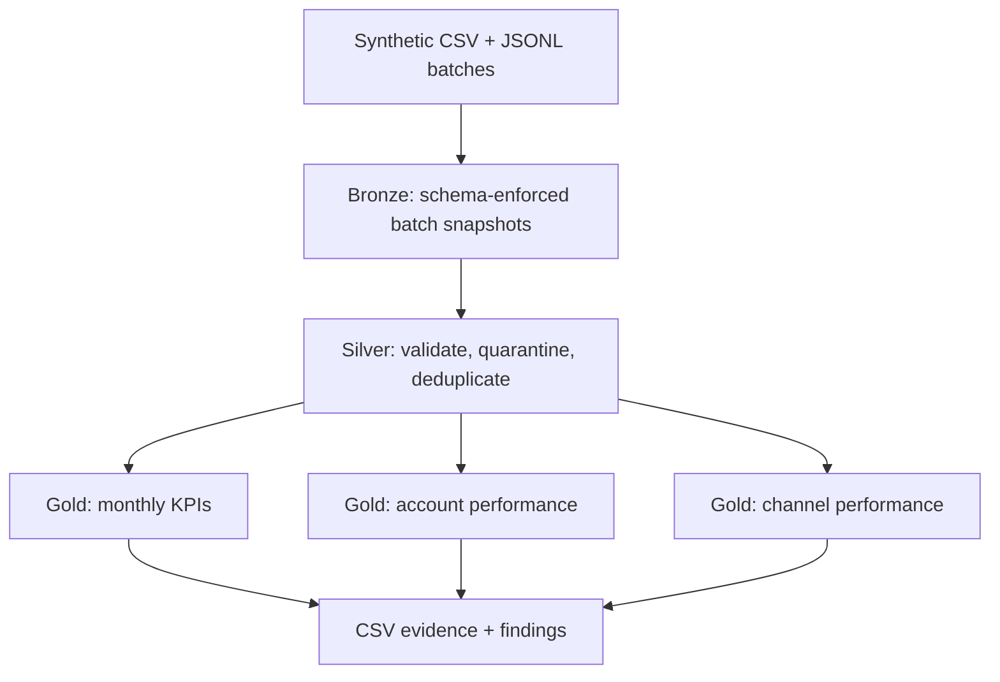

# Architecture and analytical contract

## Decision context

A collections analytics team needs trusted operational marts from duplicate-prone and occasionally invalid event deliveries. The project demonstrates an incremental batch pattern that protects KPI grain and reconciles cash totals.

## Grain and keys

| Dataset | Grain | Key / partition |
|---|---|---|
| Accounts | One registered account | `account_id` |
| Raw events | One delivered event row | Delivery may repeat `event_id` |
| Bronze events | One delivered event row per ingest batch | `ingest_batch` path |
| Silver events | One canonical event | `event_id`; partitioned by `event_month` |
| Quarantine | One rejected delivery | `ingest_batch`; reason retained |
| Gold monthly KPIs | Month × region × product | `event_month`, `region`, `product` |
| Gold account performance | Active account | `account_id` |
| Gold channel performance | Contact channel | `channel` |

## Data-quality contract

Reject a delivery if JSON is corrupt, event ID is missing, account ID is unknown, timestamp cannot be parsed, event type is outside payment/contact, amount is null/negative, a payment is nonpositive, or a contact lacks a channel. The supplied fixture intentionally triggers unknown account, invalid timestamp, and negative amount once each.

Valid rows are unioned with the prior version and ranked by `event_id`, preferring the latest lexical `ingest_batch`. Batch versions remain separate (`events_batch_01`, `events_batch_02`) so the local Parquet demonstration never mutates a source path while it is being read. The second version is the current analytical table.

This is deterministic idempotency for the supplied batch order. It is not a concurrent transactional MERGE. Production deployment should use Delta Lake, Apache Iceberg, or Apache Hudi plus orchestration, locking/concurrency controls, audit metadata, retry policy, access controls, and retention policy.

## KPI definitions

- `payments_cents`: sum of positive payment events.
- `remaining_balance_cents`: max(0, starting balance − payments) at account grain.
- Recovery ratio in findings: active-account payments / active-account starting balance.
- Contact attempts: canonical contact events.
- Right-party contacts: results `right_party_contact` or `promise_to_pay`.
- RPC rate: right-party contacts / contact attempts.
- PTP per RPC: promises to pay / right-party contacts.

The 104 registered accounts without events are omitted from account-performance and recovery denominators. This is explicit active-account scope, not missing master data.

## Performance choices

The account dimension is broadcast into event transformations. Shuffle partitions are set to eight for a small local fixture. Silver is partitioned by event month, a low-cardinality field suitable for bounded monthly reads. The pipeline does not claim benchmark improvement; no before/after runtime experiment was run.

## Reputable sources

- [Apache Spark: Parquet files](https://spark.apache.org/docs/latest/sql-data-sources-parquet.html) — schema-preserving columnar files and partition discovery.
- [Apache Spark: SQL performance tuning](https://spark.apache.org/docs/latest/sql-performance-tuning.html) — caching, partition tuning, and join strategy concepts.
- [Apache Spark: PySpark installation](https://spark.apache.org/docs/latest/api/python/getting_started/install.html) — supported installation paths and environment requirements.

Sources reviewed October 12, 2026. The repository's raw generator, pipeline, outputs, validation, and tests are the primary evidence for its results.
